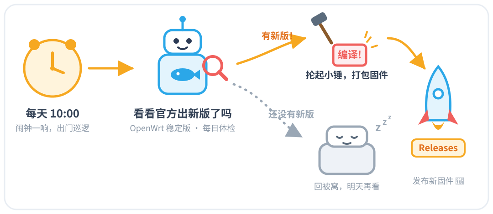

<div align="center">


<br/><br/>

# 🛡️ OpenWrt x86-64 单口旁路由固件

**全中文面板 · 导入节点即用 · mosdns DNS 前置防泄漏 · IPv6 全自动**

[📥 下载固件](#-固件下载) · [⚡ 部署](#-部署三分钟) · [🚀 OpenClash 三步上手](#-openclash-三步上手) · [🧭 DNS 架构](#-dns-分流与防泄漏) · [❓ 常见问题](#-常见问题)

</div>

---

## ✨ 这个固件是什么

一块 x86-64 固件镜像，刷机后接一根网线到主路由 LAN 口，就得到一台**开箱即用的旁路由**：

- 🇨🇳 **全中文**：系统界面与所有插件自带中文
- 🌐 **OpenClash**（Meta 内核）：预置 Rule 分流 / Fake-IP / IPv6 防泄漏参数，**只需导入节点**，其它什么都不用改
- 🧭 **mosdns DNS 前置**：国内直连、国外走代理隧道，DNS/IP **全程零泄漏**，已内置面板管理
- 🧩 **单网口旁路由形态**：本机不提供任何 DHCP 服务，地址/网关/DNS 全部自动从主路由获取，绝不与主路由抢活
- 🌍 **IPv6 全开**：v4 + v6 的地址、网关、DNS 全自动（DHCP/DHCPv6），接入设备零配置
- ⚠️ **已知限制**：零泄漏设计下，**境外域名的订阅链接首次无法直接导入**（需一次性引导，见 [OpenClash 章节](#-openclash-三步上手)）；国内域名订阅可直接用
- 🔄 **持续更新**：自动追踪 OpenWrt 官方最新稳定版，有新版本自动重新编译发布

预装服务：OpenClash · mosdns 面板 · ZeroTier · KMS 激活(vlmcsd) · Web 终端(ttyd) · dnsmasq-full · htop/nano/curl 等实用工具。

---

## 📥 固件下载

前往 **[Releases](https://github.com/zhuyihua12/openwrt-x86-official/releases)** 下载最新版，三个文件选一个：

| 文件 | 用在哪 |
|------|--------|
| `...ext4-combined-efi.img.gz` | **最常用**：物理机写 U 盘/SSD，或导入 PVE / ESXi / Unraid / VirtualBox |
| `...ext4-combined-efi.vmdk` | VMware Workstation / ESXi 直接挂载单文件 |
| `...squashfs-combined-efi.img.gz` | 需要 extroot 扩容的场景 |

> 💡 写入磁盘/导入虚拟机属于通用操作（任何写镜像工具均可），不在此赘述。

---

## ⚡ 部署（三分钟）

### 1. 接线

虚拟机/物理机**只接一个网口**，插到主路由 LAN 口（虚拟机用桥接模式）。开机。

### 2. 找到它

固件自动从主路由 DHCP 取 IP：在主路由终端列表找主机名 **`OpenWrt`**，或局域网内 `ping openwrt.lan`。

### 3. 登录

浏览器打开该 IP → 用户名 `root`，密码**空** → 建议立即设置密码。

### 4. 让流量经过它（二选一）

| 方式 | 操作 | 适合 |
|------|------|------|
| **全局接管** | 主路由 DHCP 下发选项里，把「网关 / DNS」改为旁路由 IP | 全家设备都走代理 |
| **按需接管** | 只在需要的设备上手动填 网关/DNS = 旁路由 IP | 只要几台设备走 |

> 📌 本固件**不提供 DHCP/RA/DHCPv6**，局域网地址始终由主路由分发；改主路由下发选项是唯一"全局"开关，风险可控、随时可回退。
> 如需固定旁路由管理 IP，在 LuCI「网络 → 接口 → LAN」改静态，或在主路由做 DHCP 绑定。

---

## 🚀 OpenClash 三步上手

> [!IMPORTANT]
> **使用限制（必读）：境外域名托管的订阅链接无法直接导入。**
> 本固件采用零泄漏 DNS 设计：所有境外域名（含 `gist.githubusercontent.com` 等大量机场订阅域名）
> 的解析被强制交给代理隧道，而代理恰恰需要订阅才能启动——**首次订阅必须引导一次**：
> 在电脑上用 Clash Verge 导出配置 yaml → OpenClash 上传 → 启动内核 → 之后订阅更新全部自动。
> 详见下方【引导步骤】与 [FAQ](#-常见问题)。
> ✅ 仅当订阅链接的域名**国内可直连解析**（部分机场用国内域名/CDN）时，才能跳过引导直接更新。

前提：已完成上面第 4 步（设备流量指向旁路由）。

### 首次使用 · 引导步骤（订阅域名在境外的用户必做，仅一次）

1. 电脑上用 Clash Verge（或其它客户端）正常打开你的订阅
2. 导出当前生效的配置为 **yaml 文件**
3. **OpenClash → 配置管理 → 上传配置**，选择该 yaml
4. **配置切换** 选中它 → **运行状态** 启动内核
5. 回到配置管理，对原订阅链接点 **更新** —— 此刻境外域名已能走隧道解析，订阅下载成功

完成引导后：机场换节点、订阅自动更新、GeoIP/内核更新均恢复正常，**永久无需再手工**。

### 日常三步

1. **服务 → OpenClash → 配置管理**：粘贴机场订阅链接（或手动添加节点），点「更新」
2. **配置切换**：选择节点 / 节点组，保存应用
3. **运行状态**：一键启动（固件已设开机自启内核）

**DNS / 分流 / IPv6 / 防泄漏全部已预置**，不需要打开任何其它设置页。

---

## 🧭 DNS 分流与防泄漏

```
局域网设备
   │  IPv4+IPv6 地址/网关/DNS 均由主路由自动下发（零配置）
   ▼
dnsmasq (:53) ──全部查询──▶ mosdns (:5335)
                              ├─ 国内域名(geosite cn) ──▶ 223.5.5.5 / 119.29.29.29 直连
                              └─ 国外+未命中域名 ──────▶ mihomo (:7874) ──▶ 代理隧道出境
```

| 防线 | 机制 |
|------|------|
| DNS 不泄漏 | 国外/未识别域名解析只走 mihomo 隧道（宁可不解析也不泄漏）；防火墙阻断设备直连外部 53/853（v4+v6） |
| IP 不泄漏 | OpenClash 透明代理接管流量；代理域名不发 AAAA（Fake-IP v4 栈），杜绝 IPv6 直连泄漏 |
| 无代理语义 | OpenClash 未启动时：国内网站照常，国外域名解析失败——这是防泄漏的预期行为，不是故障 |

### 常用维护（都在 LuCI 里点）

- **DNS 分流面板**：服务 → mosdns —— 广告屏蔽、黑白名单、Geo 数据更新都在这
- **DNS 重写**：固件内置 `time.android.com → 203.107.6.88`（Android 时间同步免翻墙）。加自己的规则：mosdns 面板「规则管理 → Hosts」，每行 `域名 IP`（域名在前）
- **KMS 激活**：预装 vlmcsd，局域网设备 Windows/Office 自动激活，无需配置
- **ZeroTier**：服务 → ZeroTier，加入网络 ID 即可远程回家

---

## ❓ 常见问题

**Q：刷完机后台在哪？**
主路由终端列表找 `OpenWrt`，或局域网 `ping openwrt.lan`。固件不提供固定 IP（旁路由形态由主路由分发）。

**Q：OpenClash 没启动，国外网站打不开？**
预期行为——国外域名的 DNS 被故意交给代理隧道（防泄漏），没节点就没解析。国内网站不受影响。

**Q：订阅链接点「更新」提示 Could not resolve host（如 gist.githubusercontent.com）？**
这是"先有鸡还是先有蛋"：订阅挂在境外域名上，而境外域名解析被防泄漏机制交给代理隧道——可代理恰恰需要这份订阅才能启动。**引导一次即可永久解决**：
1. 在电脑上用 Clash Verge 等客户端正常打开该订阅（你电脑上本来就订阅成功了）
2. 把当前生效的配置**导出为 yaml 文件**
3. OpenClash → 配置管理 → 上传该 yaml → 在「配置切换」选中它 → 启动内核
4. 内核跑起来后，再到配置管理点「更新订阅」——境外域名走隧道解析，此后订阅自动更新，一劳永逸

**Q：OpenClash 提示"内核下载失败 / 版本检查 network_error"？**
无需理会——固件编译打包时已内置最新 Meta 内核（mihomo，构建日随 feed 更新），不需要联网下载内核。红字只是面板去 GitHub 检查"有没有更新版"失败而已，不影响使用。只有想升级内核时才需要：代理跑起来后再点下载（走隧道即可成功），或电脑下载后手动上传替换。

**Q：更新 GeoIP / 内核 / 广告规则失败？**
先确认 OpenClash 已导入节点并启动（更新需要代理出境）；再确认设备流量已指向旁路由（第 4 步）。

**Q：和主路由会不会冲突？**
不会。本固件 DHCP/RA/DHCPv6/NDP 全部关闭，不发布任何 DHCP；主路由瘫痪时局域网设备也不受影响（只是不走代理）。

**Q：想升级版本？**
Releases 下载新镜像直接刷机；同版本系列可 sysupgrade 保留配置（跨大版本建议干净重刷）。

**Q：主路由不能改设置怎么办？**
用「按需接管」：个别设备上手动把网关/DNS 填成旁路由 IP 即可，其它设备保持原样。

---

## 🔄 固件如何保持最新



> 每天上午十点例行巡逻：官方出新稳定版才抡锤编译、上架 Releases；没有新版就回被窝，绝不浪费 GitHub 资源。也可在 Actions 页面手动触发一次「巡逻」。

---

## 📄 许可证

- **OpenWrt** — [GPL-2.0](https://github.com/openwrt/openwrt/blob/main/LICENSE)
- **本项目脚本** — [MIT License](LICENSE)

---

<div align="center">

如果这个固件对您有帮助，请点一个 ⭐ **Star** 支持一下！

Made with ❤️ by [zhuyihua12](https://github.com/zhuyihua12)

</div>
