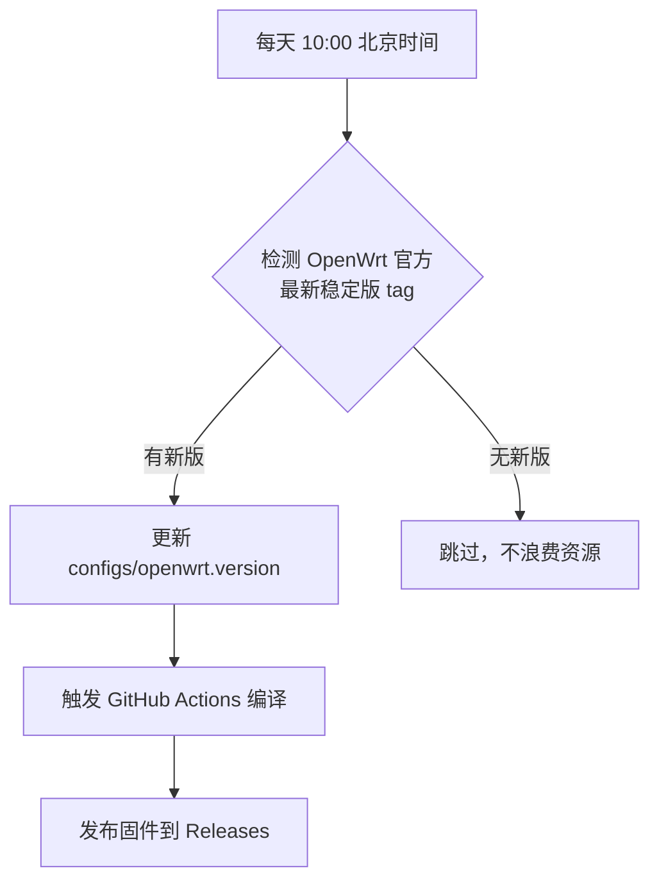

<div align="center">


<br/><br/>

# 🛡️ OpenWrt x86-64 官方源码编译固件

**自动追踪 OpenWrt 官方最新稳定版 · 全中文面板 · 单网口旁路由 · 预装常用插件**

[📥 下载固件](#-固件下载) · [🚀 快速开始](#-安装指南) · [⚙️ 预装插件](#%EF%B8%8F-预装插件) · [❓ 常见问题](#-常见问题)

</div>

---

## ✨ 项目特点

| 特性 | 说明 |
|------|------|
| 🧬 **官方纯净源码** | 基于 OpenWrt Official 最新稳定版，从源码编译 |
| 🔄 **自动追踪更新** | 每日检测 OpenWrt 官方新版本，发现更新自动编译 |
| 🇨🇳 **全中文面板** | 所有 LuCI 插件均包含中文语言包 |
| 🌐 **OpenClash** | 预装 Meta 内核（mihomo），已预置接管参数，导入节点即用 |
| 🧭 **mosdns DNS 前置** | 国内外域名智能分流，DNS 全程无泄漏 |
| 🔍 **Dnsmasq 完整版** | 替换默认版，全量转发至 mosdns，已解决与 OpenClash 冲突 |
| 📺 **KMS 激活** | 预装 vlmcsd，自动激活 Windows / Office |
| 🔗 **ZeroTier** | 内网穿透，随时随地访问家庭网络 |
| 🧩 **单口旁路由** | 一根网线接入主路由 LAN；本机自动 DHCP 获取地址/网关/DNS，**不提供 DHCP 服务**（主路由负责） |
| 🌍 **IPv6 全开** | v4+v6 地址·网关·DNS 自动从主路由获取（DHCP/DHCPv6），设备零配置 |
| 🎯 **编译精简** | Release 仅发布 `ext4/squashfs .img.gz` + `单文件 .vmdk` 三个实用文件 |

---

## 📥 固件下载

前往 **[Releases](https://github.com/zhuyihua12/openwrt-x86-official/releases)** 页面下载最新版本。

| 文件名 | 格式 | 适用场景 | 推荐度 |
|----------|----------|----------|--------|
| `openwrt-x86-64-generic-ext4-combined-efi.img.gz` | ext4 img.gz | 物理机写入 U 盘/SSD，导入 PVE/ESXi/Unraid/VirtualBox | ⭐⭐⭐⭐⭐ |
| `openwrt-x86-64-generic-ext4-combined-efi.vmdk` | 单文件 VMDK | VMware Workstation / ESXi 直接导入 | ⭐⭐⭐⭐ |
| `openwrt-x86-64-generic-squashfs-combined-efi.img.gz` | squashfs img.gz | 需要 extroot 扩容的场景 | ⭐⭐⭐ |

> 💡 每次 OpenWrt 官方发布新稳定版后，本项目会自动检测并重新编译，确保固件始终保持最新。

---

## 🚀 安装指南

### 物理机安装（U 盘 / SSD）

**Windows:** 推荐 [Rufus](https://rufus.ie/) 写入。

**Linux / macOS:**
```bash
gunzip openwrt-x86-64-combined.img.gz
sudo dd if=openwrt-x86-64-combined.img of=/dev/sdX bs=4M status=progress && sync
```
> ⚠️ 将 `/dev/sdX` 替换为实际设备，此操作会清空目标设备！

### 虚拟机安装（PVE）
```bash
gunzip openwrt-x86-64-combined.img.gz
qm importdisk 100 openwrt-x86-64-combined.img local-lvm
```
> 网卡建议选择 VirtIO（PVE）或 VMXNET3（ESXi）。

### VMware 直接使用
`.vmdk` 格式可直接挂载到 VMware Workstation / ESXi 虚拟机使用。

### 旁路由接线（推荐形态）
1. 虚拟机/物理机**单一网口**接主路由 LAN（虚拟机选桥接模式）
2. 开机后固件自动 DHCP 获取 IP，见上文「首次登录」
3. 让设备流量经过旁路由（二选一）：
   - **全局**：主路由 DHCP 下发的「网关 / DNS」改为旁路由 IP
   - **按需**：仅在需要的设备上手填网关/DNS 为旁路由 IP
4. OpenClash 导入节点、选择节点、保存应用——完成

---

## 🔑 首次登录

本固件为**单网口旁路由**：接上主路由 LAN 口后，会自动从主路由 DHCP 获取 IP。

| 项目 | 说明 |
|------|------|
| 管理地址 | 主路由 DHCP 分配的 IP（在主路由终端列表中找主机名 `OpenWrt`，或 `arp -a` / `ping openwrt.lan`） |
| 用户名 | `root` |
| 密码 | *(空)* |
| 主机名 | `OpenWrt` |
| 时区 | `Asia/Shanghai (CST-8)` |

> 💡 固件自身**不提供 DHCP/RA/DHCPv6 服务**，局域网地址统一由主路由分发。
> 如需固定管理 IP，可在 LuCI「网络 → 接口 → LAN」改为静态地址。

---

## ⚙️ 预装插件

**🌐 网络代理**
- `luci-app-openclash` — OpenClash Meta 内核，已预置 Rule 模式 / Fake-IP / IPv6 防泄漏参数

**🔍 DNS 服务**
- `mosdns` — DNS 前置分流器（已预置国内/代理双名单分流配置）
- `dnsmasq-full` — Dnsmasq 完整版，全部查询转发 mosdns

**🔗 网络工具**
- `zerotier` + `luci-app-zerotier` — 内网穿透
- `odhcp6c` / `odhcpd-full` / `luci-proto-ipv6` / `6in4` — IPv6 全家桶

**🖥️ 系统服务**
- `vlmcsd` + `luci-app-vlmcsd` — KMS 激活服务器
- `luci-app-ttyd` — Web 终端
- `openssh-sftp-server` — SFTP 文件传输
- `vsftpd` — FTP 服务

**🛠️ 实用工具**
- `curl` / `wget-ssl` — 命令行下载
- `htop` — 系统监控
- `nano` — 文本编辑器

**🌍 全中文支持**
- 所有 LuCI 插件均安装中文语言包

---

## 🧭 DNS 分流与防泄漏架构

```
局域网设备
   │  IPv4+IPv6 地址/网关/DNS 均由路由器 DHCP 自动下发（零配置）
   ▼
dnsmasq (:53) ──全部查询──▶ mosdns (:5334)
                              ├─ 国内域名名单 ──▶ 223.5.5.5 / 119.29.29.29（物理直连，不走代理）
                              └─ 代理名单+未命中 ─▶ mihomo (:7874) ──▶ 经代理节点隧道出境
```

| 防线 | 机制 |
|------|------|
| DNS 不泄漏 | 代理域名解析只经 mihomo 隧道出境；未识别域名默认走代理侧（保守策略）；防火墙阻断局域网设备直连外部 53/853（v4+v6） |
| IP 不泄漏 | OpenClash 透明代理接管 LAN 流量；代理域名不发 AAAA（Fake-IP v4 栈），杜绝 IPv6 直连泄漏 |
| 无代理兜底 | OpenClash 未启动/节点失效时，mosdns 自动回退国内公共 DNS，普通上网不受影响 |

> 📌 内置 DNS 重写：`time.android.com → 203.107.6.88`（阿里云国内 NTP，Android 时间同步免翻墙）。
> 扩展重写：编辑 `/etc/mosdns/hosts.conf`，每行 `域名 IP`（域名在前），重启 mosdns 生效。

### 🚀 OpenClash 使用（三步）
1. **OpenClash → 配置管理**：粘贴机场订阅或添加节点，点击更新
2. **OpenClash → 配置切换**：选择节点/节点组，保存应用
3. **首页开关**：一键启动（固件已默认 `enable=1`，开机自启内核）

> 分流模式已预置为 **Rule 规则分流**；DNS 已由 mosdns 全链路配好，**无需再改任何 DNS 设置**。

---

## 🔄 自动构建机制

本项目的构建策略是 **智能追踪，有更新才编译**：



| 触发方式 | 说明 |
|----------|------|
| 🤖 **智能检测** | 每日 10:00 自动检查 OpenWrt 官方是否有新稳定版 |
| 🖱️ **手动触发** | 需要时可通过 Workflow Dispatch 手动编译 |
| ⏰ ~~定时编译~~ | ~~已移除，改为按需编译~~ |

> 🎯 只有在 OpenWrt 官方发布新稳定版时才会触发编译，避免频繁无意义的构建。

---

## 📄 许可证

- **OpenWrt** — [GPL-2.0](https://github.com/openwrt/openwrt/blob/main/LICENSE)
- **本项目脚本** — [MIT License](LICENSE)

---

<div align="center">

如果这个项目对您有帮助，请点一个 ⭐ **Star** 支持一下！

Made with ❤️ by [zhuyihua12](https://github.com/zhuyihua12)

</div>
